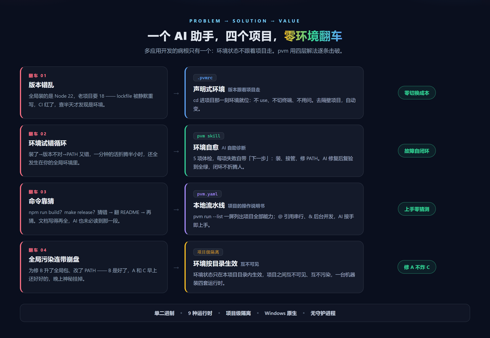
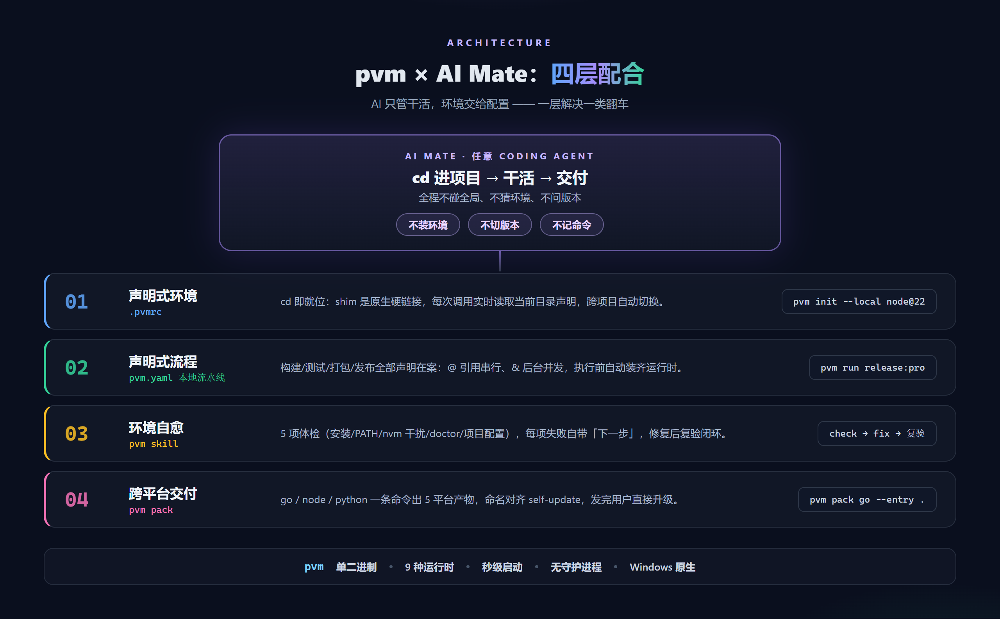
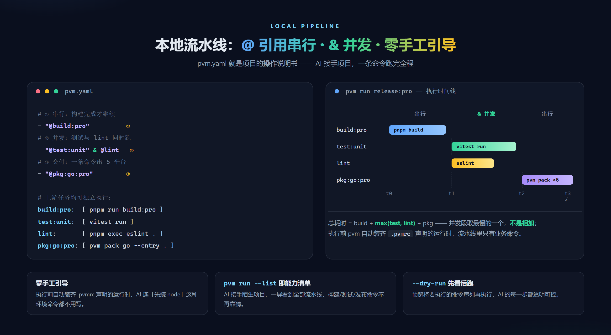

# 体验 iMate 的人，都会撞上这道环境坎：pvm 让"一个助手，多个应用"成立

> 一个应用一个助手，不够灵活；一个助手多个应用，先要解决环境问题。
> 环境问题的答案，就是 pvm。

iMate 火了——这个内部的数字同事平台，可以创建、管理和复用 AI Agent：支持接入 OpenClaw、Hermes、Claude Code、CodeBuddy 等 18+ 种引擎，7×24 小时在线，越用越懂你。用它读代码、改代码、跑任务的人越来越多。

但用它处理代码问题时，你迟早会遇到一道选择题——**助手和应用，怎么配？**

## 一、两种用法，两种命运

**用法一：一个应用，一个助手。**

每个应用配一个专属数字同事，听起来干净：上下文隔离、互不干扰。但很快你会失控——

- 应用越加越多，助手越建越多，**每新增一个应用，就要新增一个助手**
- 每个助手都要重新喂一遍应用知识、配一遍工具链
- 通用经验（怎么跑测试、怎么发版）无法跨应用复用

这不是个例，iMate 官方文档在介绍共享数字同事时，痛点写得明明白白：
*"你打磨了一套配置和 skills，但只能自己用，全组其他人都在从零配置""一人一个 IMate，相互之间难以协作"*——
**碎片化的助手，扩展成本随应用数线性增长，不够灵活。**

**用法二：一个助手，多个应用。**

一个助手带着全部上下文和技能，在多个应用之间自由切换——这才是理想形态：助手越用越聪明，应用随便加。

但它有一个绕不开的前置问题：

**环境。** A 应用是 Node 18 + pnpm 8，B 应用是 Node 22 + pnpm 9，C 应用还要 Python 3.12。助手从 A 切到 B，环境怎么办？

这个痛点也是真实的：数字同事跑在云容器或本地办公机上，环境要自己配——iwiki 上《如何配置 node 环境》的教程，第一步就是教你装 nvm。**"一台机器一套全局环境"的模式，在多应用面前到了极限**：

- 靠助手自己装？它一动手，你的全局环境就被污染了，还可能弄坏别的应用
- 靠人手动切？那就回到了 nvm 时代——**AI 不该记版本，也不该切版本**

环境问题不解决，"一个助手，多个应用"就永远只是理想。

**这正是 pvm 要回答的问题。**

---

## 二、没有隔离，AI 助手的四种翻车

pvm（Polyglot Version Manager）是一个单二进制、跨平台的运行时管理器，管 9 种运行时
（node/python/go/git/bun/deno/pnpm/yarn/rust），核心设计就一句话：**本地项目隔离——环境跟着项目走，不跟着机器走。**

在没有隔离的机器上，AI 助手有四种经典翻车：

**翻车一：版本错乱。** 全局装的是 Node 22，A 应用要 Node 18。助手直接 `npm install` —— lockfile 被静默重写，CI 红了。你以为是代码问题，查了半天是环境。

**翻车二：环境试错循环。** 脚本写好了，`python: command not found`。助手开始自动"修复"：装环境、换版本、修 PATH。一分钟的活折腾半小时——**每一步都发生在你的全局环境里**。

**翻车三：命令靠猜。** A 应用 `npm run build`，B 应用 `make release`，C 应用 `go build ./cmd/... && zip ...`。助手接手陌生应用，构建命令全靠猜：猜错 → 翻 README → 再猜。

**翻车四：全局污染连带崩盘。** 助手为修 B 升了全局包、改了 PATH。B 是好了，A 和 C 晚上神秘挂了。

四个翻车，一个病根：**环境状态没有跟着应用走，助手每次都在盲猜当前环境。**



---

## 三、pvm 的答案：AI 只管干活，环境交给配置

pvm 和 AI 助手的配合分四层，一层解决一类翻车：



### 第一层：声明式隔离 —— cd 进应用，环境自动就位

每个应用根目录放一个 `.pvmrc`，声明这个应用要什么：

```ini
node 20.20.2
pnpm 8.15.9
```

提交进 Git，环境声明从此属于应用，不属于机器。pvm 的 shim 是**原生硬链接**（不是 bash 脚本，Windows 原生可用），每次调用实时读取当前目录的 `.pvmrc`——

**助手（或任何人）cd 进应用的那一刻，node 就是 20.20.2；cd 去隔壁应用，自动变。** 不用 `use`、不用切终端、不用问。

> 助手的视角：我永远不需要知道"全局装的什么"，我只管 cd。环境是应用的事，不是我的事。

这一层直接回答了开头的选择题：**"一个助手，多个应用"的环境前提，被一个文本文件解决了。**

### 第二层：隔离地干活 —— 本地流水线，一条命令跑完全程

环境隔离了，流程也要跟着应用走。把构建/测试/打包/发布写成应用根的 `pvm.yaml`——应用的"操作说明书"：

```yaml
name: my-app
build:
  pro:
    - pnpm run build:pro
pkg:
  go:
    pro:
      - pvm pack go --entry . --output dist/app
release:
  pro:
    - "@build:pro"           # ① 串行引用：构建完才继续
    - "@test:unit & @lint"   # ② 后台并发：同时跑，取最慢
    - "@pkg:go:pro"          # ③ 交付：一条命令出 5 平台产物
```

助手接手应用，一条命令看到全部能力：

```
$ pvm run --list
build:pro      → 构建
pkg:go:pro     → 打包
release:pro    → 构建 → 测试∥lint → 打包
```



三个关键设计，都是为"AI 执行者"准备的：

- **`@` 引用串行，`&` 后台并发**：流水线在本地编排，测试和 lint 同时跑，总耗时取最慢的一个而不是相加；
- **零手工引导**：执行前 pvm 自动装齐 `.pvmrc` 声明的运行时——流水线里只有业务命令，助手连"先装 node"都不用写；
- **先看后跑**：`pvm run --dry-run` 预览将执行的命令序列，每一步透明可控。

执行 `pvm run release:pro`，一条命令跑完全程。

### 第三层：隔离环境坏了，助手自己修

pvm 官方 skill 让 AI 助手获得环境自诊断能力。跨平台 harness 脚本，五项体检：

```
[pvm] windows | cwd=D:\my-app | PVM_HOME=C:\Users\me\.pvm
[1] pvm 安装 → ✅ pvm 0.2.0
[2] shims PATH → ✅ ~/.pvm/shims 已在 PATH
[3] nvm 干扰 → ✅ nvm 存在，node 已由 pvm 接管
[4] pvm doctor → ✅ 全部检查通过
[5] 项目配置 → ✅ .pvmrc 可解析
    ℹ️ pvm.yaml 不存在（如需流水线: 在项目根创建 pvm.yaml）
------
结果: 4 通过, 0 失败 | exit=0
```

每项失败都自带「下一步」：pvm 没装就装、shims 不在 PATH 就前置、nvm 劫持 node 就接管。助手按输出执行修复，复跑体检直到全绿——**闭环在助手手里完成，你只看到"已就绪"**。机器上原来有 nvm？shims 前置接管 node，两套共存不打架。

### 第四层：隔离地产出 —— 一条命令出 5 平台产物

应用要发给用户？助手不用研究 GOOS/GOARCH、不用懂 PyInstaller：

```
$ pvm pack go --entry . --output dist/pvm
==> go build: 5 cross-platform targets (windows/amd64, linux/amd64, linux/arm64, darwin/amd64, darwin/arm64)
==> [1/5] go build (windows/amd64) -> dist\pvm-windows-amd64.exe
==> packed go: dist\pvm-windows-amd64.exe (8.8 MB, from .)
...
==> [5/5] go build (darwin/arm64) -> dist\pvm-darwin-arm64
```

node 应用走官方 SEA（自动下载各目标平台的 node 发行版做底座），python 应用走 PyInstaller。**默认跨平台全量，`--platform` 可指定单目标**——产物命名与 `pvm self-update` 的更新源约定一致，发完用户直接自更新。

---

## 四、实战：一个助手，四个应用的一天

| 时间 | 应用 | 任务 | 助手用到的 pvm 能力 |
|------|------|------|------|
| 09:00 | A（Node 18 老项目） | 修线上 bug | cd 即切 18；`pvm run test:all` 跑回归 |
| 13:00 | B（Python + Node） | 加功能 | `.pvmrc` 双运行时自动就位；装依赖零污染 |
| 16:00 | C（Go 工具） | 升依赖 + 发版 | `pvm run release:pro`；`pvm pack go` 出 5 平台产物 |
| 20:00 | D（全新应用） | 初始化 | `pvm init --local node@22` 秒起步；流水线从模板开始 |

全程零全局污染：A 的 18 和 D 的 22 同时存在于同一台机器，互不知晓，互不干扰。
**这就是"一个助手，多个应用"该有的样子——助手随便切，环境不会坏。**

---

## 五、价值总账

| 你遇到的问题 | pvm 的解法 | 你的收益 |
|------|------|------|
| 新增应用就要新增助手 | 一个助手 + 项目级隔离环境 | 助手不用重建，应用随便加 |
| 应用间版本打架 | `.pvmrc` 声明式隔离环境 | 版本跟着应用走，零切换成本 |
| 助手折腾环境半小时 | pvm skill 五项体检 + 自愈 | 故障自闭环，不折腾人 |
| 构建命令靠猜 | `pvm.yaml` 本地流水线 | `--list` 即能力清单，接手即上手 |
| 流程慢、步骤串行 | `@` 串行 + `&` 并发 | 并发段取最慢，本地流水线提速 |
| 环境步骤多、启动慢 | 单二进制 · 无守护进程 · 自动装齐运行时 | 零手工引导，执行即开始 |
| 一个应用出 5 平台 | `pvm pack` 跨平台打包 | 一条命令交付，命名对齐自更新 |
| 多应用互相污染 | 项目级隔离，环境按目录生效 | 修 A 不炸 C |

---

## 六、边界（诚实清单）

pvm 不是银弹，这些边界你和助手都要知道：

- **python 打包不能交叉平台**（PyInstaller 的硬限制）——要发多平台，在各平台分别跑或走 CI matrix
- **node 打包要求 Node ≥ 20**（官方 SEA 的要求）；darwin 产物在非 macOS 机器上打包后未签名，分发前要在 macOS 补签
- **go 交叉编译要求纯 Go 代码**（自动 `CGO_ENABLED=0`，依赖 cgo 的项目交叉会失败）
- **go/git/rust 全局唯一**，不进项目级 `.pvmrc`
- **环境变量按进程缓存**——切完版本要新开终端，IDE 要完全重启
- **pvm 只管运行时版本，不管应用依赖**——node_modules 归 npm/pnpm，分工要清楚

边界写清楚，助手才不会越界硬试——这也是"一个助手，多个应用"能稳定运转的前提。

---

## 七、现在，给你的助手一个隔离的家

AI 编程的下半场，拼的不是谁的助手更聪明，而是**谁的环境经得起助手折腾**。

**给 pvm 一个 Star**，然后三步让"一个助手，多个应用"跑起来：

1. **安装**（一行命令）：

```bash
# Windows
irm https://gitee.com/lycorxy/pvm/raw/master/scripts/install.ps1 | iex
# macOS / Linux
curl -fsSL https://gitee.com/lycorxy/pvm/raw/master/scripts/install.sh | bash
```

2. **声明应用环境**：应用根写一个 `.pvmrc`，提交进 Git
3. **把流水线交给助手**：写好 `pvm.yaml`，让助手 `pvm run release:pro`

从此你的助手 cd 到哪个应用，哪个应用的环境就是对的——**它只管干活，环境的事，配置说了算。**

---

*pvm：Polyglot Version Manager — 一个二进制，管 9 种运行时，Windows 原生。*
*GitHub：<https://github.com/Lycorxy/pvm> — 觉得有用就点个 Star ⭐*
