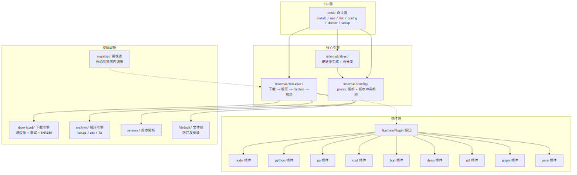
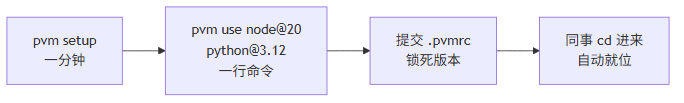

# 一个 AI 助手，一天干完四个项目的活：pvm × AI Mate 的多应用环境方案

> 场景设定：你有一个 AI 编程助手（AI Mate / 任何 Coding Agent）。它不是只服务一个项目——
> 上午在老项目修 bug，中午给混合栈项目加功能，下午升级 Go 项目并发版，晚上初始化一个新项目。
> **四个项目，四套环境。AI 靠什么不翻车？**

## 一、没有 pvm 时，AI 助手的四种翻车

**翻车一：版本错乱。**

全局装的是 Node 22，上午那个老项目要 Node 18。AI 直接 `npm install`——lockfile 被高版本 npm 静默重写，CI 照着被篡改的 lockfile 装依赖，红了。你以为是代码问题，查了半天是环境。

**翻车二：环境试错循环。**

AI 写好脚本准备跑，`python: command not found`。于是它开始装环境：装完发现版本不对，换版本；PATH 又不对，修 PATH。明明一分钟的活，环境折腾半小时——**而且每一步都发生在你的全局环境里**。

**翻车三：命令靠猜。**

A 项目 `npm run build`，B 项目 `make release`，C 项目 `go build ./cmd/... && zip ...`。AI 接手陌生项目，构建命令全靠猜：猜错 → 翻 README → 再猜。你的项目文档写得再好，AI 也未必读到那一段。

**翻车四：全局污染连带崩盘。**

AI 为了让 B 项目跑起来，升级了全局包、改了 PATH。B 是好了，A 和 C 早上还好好的，晚上就神秘挂了。

四个翻车，一个根源：**环境状态没有跟着项目走，AI 每次都在盲猜当前环境。**

---

## 二、pvm × AI Mate：四层配合

pvm（Polyglot Version Manager）是一个单二进制、跨平台的运行时版本管理器，
管 9 种运行时（node/python/go/git/bun/deno/pnpm/yarn/rust）的版本与切换。

它和 AI 助手的配合分四层，一层解决一类翻车：



### 第一层：声明式环境——AI cd 进项目，环境自动就位

每个项目根目录放一个 `.pvmrc`，声明这个项目要什么：

```ini
node 20.20.2
pnpm 8.15.9
```

提交进 Git。pvm 的 shim 是**原生硬链接**（不是 bash 脚本，Windows 原生可用），每次调用实时读取当前目录的 `.pvmrc`——

**AI（或任何人）cd 进项目的那一刻，node 就是 20.20.2；cd 去隔壁项目，自动变。** 不用 `use`、不用切终端、不用问。

> AI 的视角：我永远不需要知道"全局装的什么"，我只管 cd。环境是项目的事，不是我的事。

### 第二层：声明式流程——pvm.yaml 是项目的"操作说明书"

翻车三的解法：把每个项目的构建/测试/打包/发布写成 `pvm.yaml` 流水线，放在项目根：

```yaml
name: my-app
build:
  pro:
    - pnpm run build:pro
pkg:
  go:
    pro:
      - pvm pack go --entry . --output dist/app
release:
  pro:
    - "@build:pro"
    - "@pkg:go:pro"
```

AI 接手项目，一条命令看到全部能力：

```
$ pvm run --list
build:pro      → 构建
pkg:go:pro     → 打包
release:pro    → 构建 → 打包
```

执行 `pvm run release:pro`，一条命令跑完全程。**执行前 pvm 自动装齐 `.pvmrc` 声明的运行时**——
AI 连"先装 node 再构建"这种环境命令都不用写，流水线里只有业务命令。

### 第三层：环境自愈——AI 自助诊断，不折腾人

翻车二的解法：pvm 官方 skill 让 AI 助手获得环境自诊断能力。一个跨平台 harness 脚本，五项体检：

```
[pvm] windows | cwd=D:\my-app | PVM_HOME=C:\Users\me\.pvm
[1] pvm 安装 → ✅ pvm 0.2.0
[2] shims PATH → ✅ ~/.pvm/shims 已在 PATH
[3] nvm 干扰 → ✅ nvm 存在，node 已由 pvm 接管
[4] pvm doctor → ✅ 全部检查通过
[5] 项目配置 → ✅ .pvmrc 可解析
    ℹ️ pvm.yaml 不存在（如需流水线: 在项目根创建 pvm.yaml）
------
结果: 4 通过, 0 失败 | exit=0
```

每项失败都自带「下一步」：pvm 没装就装、shims 不在 PATH 就前置、nvm 劫持 node 就接管。
AI 按输出执行修复，复跑体检直到全绿——**闭环在 AI 手里完成，用户只看到"已就绪"**。

机器上原来有 nvm？pvm 的 shims 会前置到 PATH，node 由 pvm 接管，两套共存不打架。

### 第四层：打包发布——一条命令出 5 平台产物

项目要发给用户？AI 不用研究 GOOS/GOARCH、不用懂 PyInstaller：

```
$ pvm pack go --entry . --output dist/pvm
==> go build: 5 cross-platform targets (windows/amd64, linux/amd64, linux/arm64, darwin/amd64, darwin/arm64)
==> [1/5] go build (windows/amd64) -> dist\pvm-windows-amd64.exe
==> packed go: dist\pvm-windows-amd64.exe (8.8 MB, from .)
==> [2/5] go build (linux/amd64) -> dist\pvm-linux-amd64
...
==> [5/5] go build (darwin/arm64) -> dist\pvm-darwin-arm64
```

node 项目走官方 SEA（AI 自动下载各目标平台的 node 发行版做底座），python 项目走 PyInstaller。
**默认跨平台全量，`--platform` 可指定单目标**——发布产物命名与 `pvm self-update` 的更新源约定一致，发完用户直接自更新。

---

## 三、实战：AI 助手的一天

| 时间 | 项目 | 任务 | AI 用到的 pvm 能力 |
|------|------|------|------|
| 09:00 | A（Node 18 老项目） | 修线上 bug | cd 即切 18；`pvm run test:all` 跑回归 |
| 13:00 | B（Python + Node） | 加功能 | `.pvmrc` 双运行时自动就位；装依赖零污染 |
| 16:00 | C（Go 工具） | 升依赖 + 发版 | `pvm run release:pro`；`pvm pack go` 出 5 平台产物 |
| 20:00 | D（全新项目） | 初始化 | `pvm init --local node@22`；流水线从模板起步 |

全程零全局污染：A 的 18 和 D 的 22 同时存在于同一台机器，互不知晓，互不干扰。



---

## 四、边界（诚实清单）

pvm 不是银弹，这些边界 AI 和你都要知道：

- **python 打包不能交叉平台**（PyInstaller 的硬限制）——要发多平台，在各平台分别跑或走 CI matrix
- **node 打包要求 Node ≥ 20**（官方 SEA 的要求）；darwin 产物在非 macOS 机器上打包后未签名，分发前要在 macOS 补签
- **go 交叉编译要求纯 Go 代码**（自动 `CGO_ENABLED=0`，依赖 cgo 的项目交叉会失败）
- **go/git/rust 全局唯一**，不进项目级 `.pvmrc`
- **环境变量按进程缓存**——切完版本要新开终端，IDE 要完全重启
- **pvm 只管运行时版本，不管应用依赖**——node_modules 归 npm/pnpm，分工要清楚

边界写清楚，AI 才不会越界硬试——这也是"AI 助手多项目开发"能稳定运转的前提。

---

## 五、总结：环境即配置，AI 即执行者

- **`.pvmrc`** 回答"这个项目要什么环境"——AI cd 进来就对，不用装不用猜
- **`pvm.yaml`** 回答"这个项目怎么构建/打包/发布"——AI 一条 `pvm run` 执行，不用记命令
- **pvm skill** 回答"环境坏了怎么办"——AI 自助体检修复，不折腾用户
- **`pvm pack`** 回答"怎么交付"——跨平台产物一条命令

多应用开发的本质矛盾是"每个项目都想要自己的环境，但机器只有一台"。pvm 把环境变成随项目走的配置，
AI 助手从"环境盲猜者"变成"纯执行者"——**它只管干活，环境的事，配置说了算。**

三个命令带走：

```bash
cd my-app          # 环境自动就位
pvm run release:pro  # 流程一条命令
pvm pack go          # 跨平台一条命令
```

---

*pvm：Polyglot Version Manager — 一个二进制，管 9 种运行时，Windows 原生。*
*安装：`irm https://gitee.com/lycorxy/pvm/raw/master/scripts/install.ps1 | iex`（Windows）/ `curl -fsSL https://gitee.com/lycorxy/pvm/raw/master/scripts/install.sh | bash`（macOS/Linux）*
